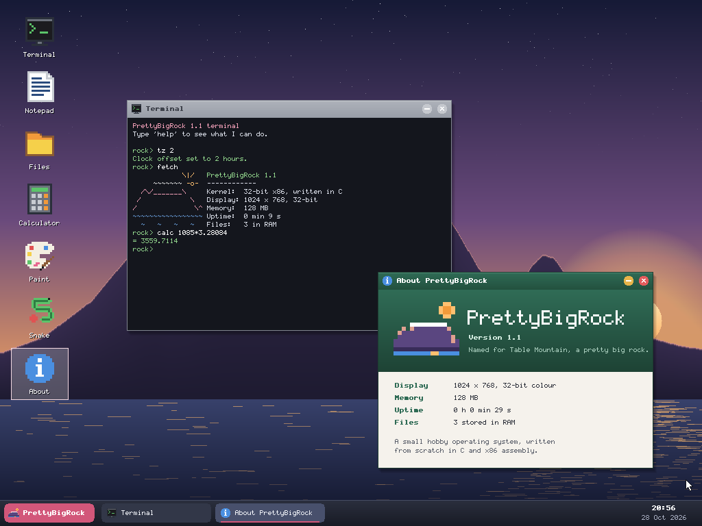
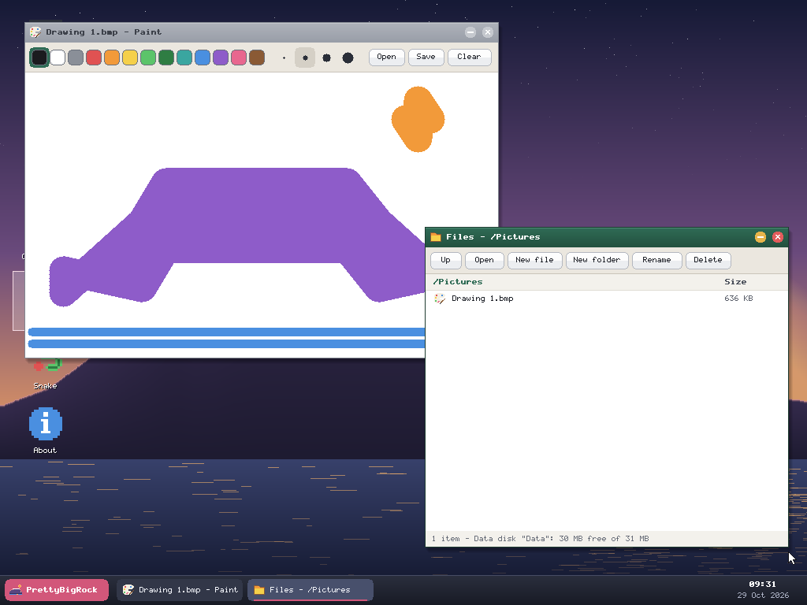

# PrettyBigRock

An operating system written from scratch, named after Table Mountain, a pretty big rock.

This repository holds two generations:

- **PrettyBigRock 1.x** ([`classic/`](classic/)): a small 32-bit x86 system with a graphical
  desktop, written in C. Boot loader, kernel, drivers, bitmap font, icons, window manager, its
  own filesystem, and apps. Table Mountain is its wallpaper, drawn procedurally at boot, at
  dusk, tablecloth and all. It works today; everything from "What's inside" below is about it.
- **PrettyBigRock 2** (everything else): a new design, meant to grow into an operating system
  you'd actually use, on real computers. It's a 64-bit microkernel written in Rust, for x86-64
  and ARM64 (including the Raspberry Pi 5), where every app and every driver runs in its own
  sandbox. It's at the very start: the design is in [docs/DESIGN.md](docs/DESIGN.md), the plan
  is in [docs/ROADMAP.md](docs/ROADMAP.md), and the detailed design notes are in
  [docs/design/](docs/design/).



## How this was made

The first version was written by **Claude** (Anthropic's AI model) from a single prompt by Chris:
*"Could you write me an operating system that I could boot in a VM. This OS should have a GUI.
Try not to plagiarise too much."* Claude wrote every line of code, the font and the icons.
It was called **FynbosOS** at first; that original is kept in this repository's history under
the tag `fynbos-1.0`, and was renamed to PrettyBigRock in version 1.1.
From here on, Chris and Claude are developing it together, and [DEVLOG.md](DEVLOG.md)
records who did what in each session. Chris directs; Claude writes the code and the documents.

## PrettyBigRock 2: building it

Needs [rustup](https://rustup.rs); the right Rust version installs itself the first time.

```
cargo xtask build      # the kernel, for every architecture, into build/<arch>/
cargo xtask ci         # formatting, lints, tests and builds: what GitHub runs on every change
cargo xtask doctor     # how the toolchain was found
```

So far the kernel builds and does nothing else. Booting it is milestone M1.

# PrettyBigRock 1.x (classic)

## What's inside

- **Boot loader** (`classic/boot/`): a 512-byte MBR that loads the rest with BIOS LBA reads, then a
  second stage that scans the VESA mode list for the best linear-framebuffer mode
  (1024x768x32 preferred, falls back to 800x600 or 640x480, 32- or 24-bit), enables A20
  and switches to protected mode.
- **Kernel** (`classic/kernel/`): IDT and remapped PICs, 100 Hz PIT timer, PS/2 keyboard and mouse,
  CMOS clock, ACPI soft power-off (parses the FADT and DSDT `\_S5`), reboot, and a crash screen.
- **Graphics**: double-buffered drawing with clipping and dirty-rectangle updates, alpha
  blending, gradients, rounded shapes, and a hand-drawn 5x9 font.
- **Window manager**: overlapping draggable windows with shadows, focus, minimise/close,
  taskbar with clock, start menu (Windows key or Ctrl+Esc), desktop icons.
- **Storage**: an ATA (IDE) disk driver and **RockFS**, PrettyBigRock's own filesystem, with
  folders, long names, copy-on-write saving that survives power cuts, and a check-and-repair
  routine. The design is in [docs/ROCKFS.md](docs/ROCKFS.md). Without a data disk, files are
  kept on a RAM disk instead.
- **Mouse**: PS/2, plus the absolute pointer used by QEMU, VMware and browser emulators, so
  the mouse doesn't need capturing and touch screens work.
- **Apps**: Terminal (about 30 commands, folders, history, scrollback), Notepad, Files,
  Calculator, Paint (saves and opens .bmp pictures), Snake and About.
- **Browser player** (`classic/web/`): runs PrettyBigRock in a web page using the v86 emulator, with
  touch as the mouse and an on-screen keyboard, so it works on tablets.

## Running it

Download the disk image for your hypervisor from the **Releases** page (or build it yourself,
below), and put it in a `classic/build/` folder:

| Hypervisor | File | Notes |
|---|---|---|
| QEMU / Proxmox | `prettybigrock.img` | `qemu-system-i386 -m 128 -drive file=prettybigrock.img,format=raw,index=0 -drive file=data.img,format=raw,index=1`, or on Windows double-click `classic/run-prettybigrock.bat` |
| VirtualBox | `prettybigrock.vdi` | New VM, type *Other*, version *Other/Unknown*, 64 MB+ RAM, attach as the hard disk |
| VMware | `prettybigrock.vmdk` | New VM, guest *Other*, use an existing disk, BIOS firmware |

**Your files** need a second, blank virtual disk; PrettyBigRock offers to set it up the first
time it sees one. On Windows, `classic/run-prettybigrock.bat` makes one for you (`classic/data.img`, 64 MB).
In VirtualBox or VMware, add a second hard disk to the VM. Without one, files are kept in
memory and disappear when you restart.



**Getting files in and out**: `tools/rockfs.py` reads and writes RockFS disks from Windows,
Linux or macOS (Python 3, nothing else to install). Shut PrettyBigRock down first, then:

```
python tools/rockfs.py classic/data.img ls -R
python tools/rockfs.py classic/data.img get "/Pictures/Drawing 1.bmp"
python tools/rockfs.py classic/data.img put notes.txt /Documents/notes.txt
python tools/rockfs.py classic/data.img check
```

Requirements: **legacy BIOS boot** (not UEFI) and a **PS/2 mouse**. In VirtualBox set
System > Pointing Device to *PS/2 Mouse*; with the default USB tablet the pointer won't move.
The VM captures the mouse when you click inside it (host key releases it).

The clock shows the VM's hardware time, which is usually UTC. In the Terminal, `tz 2` switches it to SAST.

## Building

Needs `gcc` (with `-m32` support), `nasm`, `ld`, `objcopy` and Python 3; `qemu-img` is optional
(for the .vdi/.vmdk conversions).

```
classic/build.sh
```

## Testing

`tools/test_rockfs.py` runs the Python RockFS through thousands of random operations, a
fragmented disk, a full disk and simulated power cuts. `classic/tools/hosttest/` builds the kernel's
own RockFS code as an ordinary program and checks it against the Python version in both
directions, including 40 power cuts at random moments:

```
cargo xtask classic        # builds 1.x and runs the cross-checks
python3 tools/test_rockfs.py
```

# Licence

Copyright (C) 2026 Christopher Cameron-Dow

PrettyBigRock is free software: you can redistribute it and/or modify it under the terms of the
GNU General Public License as published by the Free Software Foundation, either version 3
of the License, or (at your option) any later version. It is distributed in the hope that it
will be useful, but WITHOUT ANY WARRANTY. See [LICENSE](LICENSE) for the full text.

The app libraries of PrettyBigRock 2 will carry a linking exception, so that apps can be
written under any licence (DESIGN.md section 9.1).

# Known limits of 1.x

Single-tasking, no networking, US keyboard layout, no mouse wheel, and the apps can only type
plain English (ASCII) text, although RockFS itself stores any Unicode name.
